# 00 — Index et feuille de route (`buntu-tizen`)

> **Rôle de l'agent IA :** tu es un ingénieur logiciel senior spécialisé en **TypeScript, applications web Tizen pour Samsung TV, AVPlay et interfaces 10-foot**.
> **Règle d'or :** chaque fichier `PRD/*.md` couvre **une seule responsabilité**, à implémenter, tester et valider de bout en bout avant de passer au suivant.

---

## 1. État du projet

Ce dépôt ne contient **aucun code d'application**. Il fixe les spécifications de la version Samsung Tizen de Buntu. `Buntu` désigne le dépôt voisin `../buntu`, qui reste la référence fonctionnelle et n'est pas modifié ici.

## 2. Conventions

- **Identifiants :** `PRD-NN` renvoie à ce dépôt. `BUNTU-PRD-NN` renvoie à un PRD du dépôt Buntu.
- **SRP :** chaque PRD a une section « Responsabilité » qui dit ce qu'il fait et ce qu'il ne fait pas, avec le PRD qui s'en charge.
- **Ordre :** un PRD ne dépend que de numéros inférieurs. La numérotation est donc un ordre de construction valide.
- **Référence vers un numéro supérieur :** ce n'est pas une dépendance. Elle désigne un point d'extension ou une frontière de responsabilité.
- **Niveaux de certitude :** `[DOC]`, `[NON DOC]`, `[COMM]`, `[CIBLE]`, définis dans [`docs/TIZEN_FACTS.md`](../docs/TIZEN_FACTS.md). `[DOC, résumé]` signale un fait lu dans un résumé d'une page tronquée, à relire avant de s'y fier.
- **Preuves :** `S1` à `S15` sont définies dans le [`PRD-03`](./03_SPIKES_VALIDATION_TV_REELLE.md).

## 3. Directives pour tous les agents

1. **Technologie :** application web `.wgt` en TypeScript. Pas de code natif, pas de service de fond, pas de serveur Buntu.
2. **Anti-OOM :** aucune playlist, aucun XMLTV ni aucun gros JSON chargé en entier. Aucun catalogue complet en mémoire.
3. **Fil principal :** réseau, stockage et analyse dans le Worker. `webapis` et `tizen` seulement dans `src/platform/`.
4. **Sans contenu :** aucune source ni URL réelle dans l'app, le dépôt, les tests ou les captures.
5. **Secrets :** jamais dans IndexedDB, `localStorage`, le dépôt ou un journal.
6. **Parité :** une règle métier vient de `cnd-core` et de ses tests. Un écart s'écrit dans le PRD.
7. **Fin d'un PRD :** tests, typage et linter au vert, budgets respectés, critères d'acceptation vérifiés. Ce qui touche à la lecture se vérifie sur TV réelle.
8. **Mise à jour :** cocher le statut ici. Tout fait nouveau sur Tizen va dans `docs/TIZEN_FACTS.md`.

## 4. Portes de décision

Aucun code de production avant ces deux portes :

| Porte | Condition | PRD |
| :--- | :--- | :---: |
| **Technique** | `S1`, `S3` et `S8` réussies sur TV réelle | 03 |
| **Distribution** | Réponse de Samsung et statut de vendeur connus, ou décision écrite de continuer sans | 04 |

Les deux sont indépendantes et peuvent avancer en parallèle.

## 5. Risques principaux

| Risque | Effet | Traitement |
| :--- | :--- | :--- |
| CORS bloque les serveurs IPTV | Produit impossible | `S1`, repli `tizen.download` |
| Samsung refuse ce type d'app | Pas de boutique | `PRD-04`, avant de construire |
| Public Seller limité aux États-Unis | Pas de France ni d'Afrique sans contrat | `PRD-04` |
| Flux refusés par AVPlay, sans `libmpv` en secours | Chaînes illisibles | `S3`, `S4`, `PRD-29` |
| En-têtes `Referer` impossibles | Certaines sources illisibles | Limite annoncée, `PRD-29` |
| IndexedDB trop lent à cette échelle | Catalogue plafonné | `S8`, `PRD-06` |
| Certificat d'auteur perdu | Plus de mise à jour possible | `PRD-50` |
| Pas de TV réelle ni de machine x86 | Rien de vérifiable | `PRD-02`, `PRD-51` |

## 6. Décisions ouvertes

| # | Décision | Recommandation | À trancher avant |
| :---: | :--- | :--- | :---: |
| D1 | Qui publie (personne ou société), et dans quels pays ? | Contacter Samsung tôt ; viser Partner Seller si la France et l'Afrique sont visées | Porte Distribution |
| D2 | Année minimale | 2021 (Tizen 6.0) ; 2020 seulement si `S7` et `S8` le permettent | `PRD-05` |
| D3 | Confirmer TypeScript + IndexedDB, sans Rust ni serveur | Oui, après `S8` | `PRD-06` |
| D4 | Matériel : quelles TV, et une machine x86 ? | Au moins deux TV ; x86 si `S13` échoue | `PRD-03` |
| D5 | Qui héberge la source de démonstration libre de droits ? | Un petit hébergement de l'éditeur | `PRD-52` |
| D6 | Accepter les sources en `http://` ? | Oui avec avertissement, car beaucoup de serveurs n'offrent que cela ; à confirmer avec Samsung | `PRD-09` |
| D7 | Découpage v1 et v1.1 du § 8 | Valider ou déplacer des PRD | `PRD-05` |
| D8 | Licence, nom public, vérification de marque | Reprendre `MIT OR Apache-2.0` ; faire vérifier « Buntu » | `PRD-50` |

## 7. Graphe de dépendances

Graphe réduit : une dépendance déjà impliquée par une autre n'est pas dessinée. Le tableau du § 8 donne les dépendances directes complètes.

```mermaid
flowchart TD
    subgraph A["A. Cadrage"]
        P01["01 Périmètre et matrice de portage"]
        P02["02 Plateforme cible et chaîne d'outils"]
        P03["03 Preuves techniques sur TV réelle"]
        P04["04 Conformité d'un lecteur de type IPTV"]
    end
    subgraph B["B. Socle"]
        P05["05 Architecture applicative"]
        P06["06 Stockage et échelle du catalogue"]
        P07["07 Stockage sécurisé des identifiants"]
        P08["08 Journaux et masquage des secrets"]
        P09["09 Client réseau"]
        P10["10 Réglages persistants"]
        P11["11 Cycle de vie de l'application"]
        P12["12 Budgets de performance et de mémoire"]
        P13["13 Localisation"]
    end
    subgraph C["C. Interface 10-foot"]
        P14["14 Télécommande et navigation au focus"]
        P15["15 Système visuel « 10-foot »"]
        P16["16 Saisie de texte à la télécommande"]
        P17["17 Accessibilité"]
        P18["18 Coquille de navigation et premier lancement"]
    end
    subgraph D["D. Données"]
        P19["19 Normalisation des titres et des séries"]
        P20["20 Ingestion M3U en flux"]
        P21["21 Client Xtream Codes"]
        P22["22 Gestion et synchronisation des sources"]
        P23["23 Guide TV : ingestion et requêtes"]
        P24["24 Requêtes de catalogue"]
        P25["25 Moteur de recherche plein texte"]
        P26["26 Favoris, historique et reprise"]
        P27["27 Métadonnées OMDb et TMDB"]
    end
    subgraph E["E. Lecture"]
        P28["28 Moteur de lecture AVPlay"]
        P29["29 Formats pris en charge et routage des flux"]
        P30["30 Surveillance et reconnexion"]
        P31["31 Pistes audio et sous-titres intégrés"]
        P32["32 Interface du lecteur"]
        P33["33 Replay et « Revoir depuis le début »"]
        P34["34 Miroirs et bascule automatique"]
    end
    subgraph F["F. Écrans"]
        P35["35 Écrans de gestion des sources"]
        P36["36 Écran Live TV"]
        P37["37 Écran Guide TV"]
        P38["38 Écran Films"]
        P39["39 Écran Séries"]
        P40["40 Écran Recherche"]
        P41["41 Écrans Réglages et console des journaux"]
    end
    subgraph G["G. Fonctions avancées"]
        P42["42 Accès au stockage USB"]
        P43["43 Import de sources par fichier"]
        P44["44 Médias locaux sur clé USB"]
        P45["45 Profils et contrôle parental"]
        P46["46 Assistant de chaînes"]
        P47["47 Recommandations « À suivre »"]
        P48["48 Sous-titres en ligne"]
        P49["49 Mosaïque"]
    end
    subgraph H["H. Livraison"]
        P50["50 Paquet, signature et certificats"]
        P51["51 QA sur émulateur et TV réelles"]
        P52["52 Soumission au Seller Office"]
    end
    P01 --> P02
    P02 --> P03
    P01 --> P04
    P03 --> P05
    P05 --> P06
    P05 --> P07
    P05 --> P08
    P08 --> P09
    P06 --> P10
    P05 --> P11
    P05 --> P12
    P05 --> P13
    P11 --> P14
    P05 --> P15
    P14 --> P16
    P14 --> P17
    P15 --> P17
    P13 --> P18
    P14 --> P18
    P15 --> P18
    P05 --> P19
    P06 --> P20
    P07 --> P20
    P09 --> P20
    P19 --> P20
    P20 --> P21
    P10 --> P22
    P11 --> P22
    P21 --> P22
    P22 --> P23
    P06 --> P24
    P19 --> P24
    P24 --> P25
    P24 --> P26
    P07 --> P27
    P09 --> P27
    P24 --> P27
    P08 --> P28
    P11 --> P28
    P21 --> P29
    P28 --> P29
    P29 --> P30
    P28 --> P31
    P18 --> P32
    P30 --> P32
    P31 --> P32
    P23 --> P33
    P29 --> P33
    P24 --> P34
    P30 --> P34
    P16 --> P35
    P18 --> P35
    P22 --> P35
    P23 --> P36
    P26 --> P36
    P32 --> P36
    P18 --> P37
    P33 --> P37
    P26 --> P38
    P27 --> P38
    P32 --> P38
    P26 --> P39
    P27 --> P39
    P32 --> P39
    P16 --> P40
    P18 --> P40
    P25 --> P40
    P07 --> P41
    P08 --> P41
    P10 --> P41
    P16 --> P41
    P18 --> P41
    P05 --> P42
    P35 --> P43
    P42 --> P43
    P18 --> P44
    P28 --> P44
    P42 --> P44
    P04 --> P45
    P07 --> P45
    P18 --> P45
    P25 --> P45
    P16 --> P46
    P25 --> P46
    P36 --> P46
    P26 --> P47
    P27 --> P47
    P32 --> P47
    P32 --> P48
    P36 --> P49
    P02 --> P50
    P04 --> P50
    P12 --> P51
    P50 --> P51
    P17 --> P52
    P45 --> P52
    P51 --> P52
```

## 8. Liste séquentielle des PRD

Le statut se coche ainsi : `[ ]` à faire, `[~]` en cours, `[x]` terminé.

| Ordre | Fichier PRD | Périmètre | Dépend de | Lot | Statut |
| :---: | :--- | :--- | :--- | :---: | :---: |
| **01** | [`01_PERIMETRE_MATRICE_PORTAGE.md`](./01_PERIMETRE_MATRICE_PORTAGE.md) | Décision de portage de chaque fonction Buntu : portée, remplacée, abandonnée. | — | v1 | `[ ]` |
| **02** | [`02_PLATEFORME_TOOLCHAIN.md`](./02_PLATEFORME_TOOLCHAIN.md) | Type d'application, années TV prises en charge, outils, poste de développement. | 01 | v1 | `[ ]` |
| **03** | [`03_SPIKES_VALIDATION_TV_REELLE.md`](./03_SPIKES_VALIDATION_TV_REELLE.md) | Preuves sur TV réelle des points non documentés, porte Go / Révision / Arrêt. | 02 | v1 | `[ ]` |
| **04** | [`04_CONFORMITE_CONTENU_IPTV.md`](./04_CONFORMITE_CONTENU_IPTV.md) | Position de Samsung, statut de vendeur, règles de contenu, source de démonstration. | 01 | v1 | `[ ]` |
| **05** | [`05_ARCHITECTURE_APPLICATIVE.md`](./05_ARCHITECTURE_APPLICATIVE.md) | Couches, moteur dans un Worker, ports de plateforme, tests de parité avec `cnd-core`. | 02, 03 | v1 | `[ ]` |
| **06** | [`06_STOCKAGE_ECHELLE_CATALOGUE.md`](./06_STOCKAGE_ECHELLE_CATALOGUE.md) | **Décision centrale** : TypeScript + IndexedDB, schéma, générations, quota. | 03, 05 | v1 | `[ ]` |
| **07** | [`07_SECRETS_IDENTIFIANTS.md`](./07_SECRETS_IDENTIFIANTS.md) | Coffre `widgetdata`, URL sans identifiants, effacement. | 03, 05 | v1 | `[ ]` |
| **08** | [`08_JOURNAUX_TELEMETRIE_LOCALE.md`](./08_JOURNAUX_TELEMETRIE_LOCALE.md) | Anneau de journaux et masquage des secrets, sans envoi extérieur. | 05 | v1 | `[ ]` |
| **09** | [`09_CLIENT_RESEAU.md`](./09_CLIENT_RESEAU.md) | Accès réseau unique : CORS, flux continu, gzip, annulation. | 03, 05, 08 | v1 | `[ ]` |
| **10** | [`10_REGLAGES_PERSISTANTS.md`](./10_REGLAGES_PERSISTANTS.md) | Modèle et persistance des réglages. | 05, 06 | v1 | `[ ]` |
| **11** | [`11_CYCLE_DE_VIE_APPLICATION.md`](./11_CYCLE_DE_VIE_APPLICATION.md) | Sortie, multitâche, perte de réseau, écran de veille. | 02, 05 | v1 | `[ ]` |
| **12** | [`12_PERFORMANCE_MEMOIRE.md`](./12_PERFORMANCE_MEMOIRE.md) | Budgets chiffrés, règles communes, méthode de mesure. | 03, 05 | v1 | `[ ]` |
| **13** | [`13_LOCALISATION.md`](./13_LOCALISATION.md) | Dictionnaires français et anglais, formats. | 05 | v1 | `[ ]` |
| **14** | [`14_TELECOMMANDE_NAVIGATION_FOCUS.md`](./14_TELECOMMANDE_NAVIGATION_FOCUS.md) | Touches, moteur de focus, mémoire du focus. | 05, 11 | v1 | `[ ]` |
| **15** | [`15_DESIGN_SYSTEM_10_FOOT.md`](./15_DESIGN_SYSTEM_10_FOOT.md) | Jetons de marque, grille 1920×1080, composants. | 02, 05 | v1 | `[ ]` |
| **16** | [`16_SAISIE_TEXTE_IME.md`](./16_SAISIE_TEXTE_IME.md) | Champs, clavier virtuel, codes IME. | 14 | v1 | `[ ]` |
| **17** | [`17_ACCESSIBILITE_VOICE_GUIDE.md`](./17_ACCESSIBILITE_VOICE_GUIDE.md) | Guide vocal, libellés, dossier EAA. | 14, 15 | v1 | `[ ]` |
| **18** | [`18_NAVIGATION_SHELL.md`](./18_NAVIGATION_SHELL.md) | Menu, pile d'écrans, premier lancement. | 11, 13, 14, 15 | v1 | `[ ]` |
| **19** | [`19_NORMALISATION_TITRES_SERIES.md`](./19_NORMALISATION_TITRES_SERIES.md) | Port de `normalizer.rs` : type, titre, saison, épisode. | 05 | v1 | `[ ]` |
| **20** | [`20_INGESTION_M3U.md`](./20_INGESTION_M3U.md) | Analyse M3U en flux, par lots. | 06, 07, 09, 19 | v1 | `[ ]` |
| **21** | [`21_CLIENT_XTREAM.md`](./21_CLIENT_XTREAM.md) | `player_api.php`, repli M3U+, chargement des séries à la demande. | 06, 07, 09, 19, 20 | v1 | `[ ]` |
| **22** | [`22_ORCHESTRATION_SYNC_SOURCES.md`](./22_ORCHESTRATION_SYNC_SOURCES.md) | Cycle de vie des sources, file et planification de synchronisation. | 07, 10, 11, 20, 21 | v1 | `[ ]` |
| **23** | [`23_INGESTION_EPG.md`](./23_INGESTION_EPG.md) | XMLTV en flux, fenêtre réduite, requêtes Now/Next, guide Xtream à la demande. | 06, 09, 22 | v1 | `[ ]` |
| **24** | [`24_REQUETES_CATALOGUE.md`](./24_REQUETES_CATALOGUE.md) | Listes paginées par curseur, facettes, tris, `visibilityFilter`. | 06, 19 | v1 | `[ ]` |
| **25** | [`25_RECHERCHE_PLEIN_TEXTE.md`](./25_RECHERCHE_PLEIN_TEXTE.md) | Index maison de préfixes dans IndexedDB. | 06, 19, 24 | v1 | `[ ]` |
| **26** | [`26_FAVORIS_HISTORIQUE_REPRISE.md`](./26_FAVORIS_HISTORIQUE_REPRISE.md) | Favoris, récents, reprise. | 06, 24 | v1 | `[ ]` |
| **27** | [`27_METADONNEES_OMDB_TMDB.md`](./27_METADONNEES_OMDB_TMDB.md) | Enrichissement à la demande, clés de l'utilisateur. | 06, 07, 09, 24 | v1 | `[ ]` |
| **28** | [`28_MOTEUR_AVPLAY.md`](./28_MOTEUR_AVPLAY.md) | Automate AVPlay derrière `PlayerPort`. | 03, 05, 08, 11 | v1 | `[ ]` |
| **29** | [`29_FORMATS_ROUTAGE_FLUX.md`](./29_FORMATS_ROUTAGE_FLUX.md) | Table de formats, choix de l'URL, messages d'échec. | 03, 21, 28 | v1 | `[ ]` |
| **30** | [`30_ROBUSTESSE_RECONNEXION.md`](./30_ROBUSTESSE_RECONNEXION.md) | Détection de blocage, 3 reconnexions. | 11, 28, 29 | v1 | `[ ]` |
| **31** | [`31_PISTES_AUDIO_SOUS_TITRES.md`](./31_PISTES_AUDIO_SOUS_TITRES.md) | Sélection de pistes, rendu des sous-titres intégrés. | 03, 28 | v1 | `[ ]` |
| **32** | [`32_INTERFACE_LECTEUR.md`](./32_INTERFACE_LECTEUR.md) | Bandeau, commandes, mini-lecteur. | 14, 15, 18, 28, 30, 31 | v1 | `[ ]` |
| **33** | [`33_REPLAY_START_OVER.md`](./33_REPLAY_START_OVER.md) | Port de `catchup.rs`, remplace la pause locale et le PVR. | 21, 23, 28, 29 | v1 | `[ ]` |
| **34** | [`34_MIROIRS_BASCULE.md`](./34_MIROIRS_BASCULE.md) | Chaînes équivalentes et bascule, sans sonde de fond. | 24, 30 | v1.1 | `[ ]` |
| **35** | [`35_ECRANS_SOURCES.md`](./35_ECRANS_SOURCES.md) | Liste, formulaires, test du compte, erreurs. | 16, 18, 22 | v1 | `[ ]` |
| **36** | [`36_ECRAN_LIVE_TV.md`](./36_ECRAN_LIVE_TV.md) | Catégories, chaînes, Now/Next visibles. | 18, 23, 24, 26, 32 | v1 | `[ ]` |
| **37** | [`37_ECRAN_GUIDE_EPG.md`](./37_ECRAN_GUIDE_EPG.md) | Grille horaire au focus, fiche de programme. | 18, 23, 33 | v1 | `[ ]` |
| **38** | [`38_ECRAN_FILMS.md`](./38_ECRAN_FILMS.md) | Grille d'affiches, fiche, reprise. | 18, 24, 26, 27, 32 | v1 | `[ ]` |
| **39** | [`39_ECRAN_SERIES.md`](./39_ECRAN_SERIES.md) | Grille, saisons, épisodes, lecture enchaînée. | 18, 21, 24, 26, 27, 32 | v1 | `[ ]` |
| **40** | [`40_ECRAN_RECHERCHE.md`](./40_ECRAN_RECHERCHE.md) | Saisie et résultats groupés. | 16, 18, 25 | v1 | `[ ]` |
| **41** | [`41_ECRAN_REGLAGES_CONSOLE.md`](./41_ECRAN_REGLAGES_CONSOLE.md) | Réglages, clés, cache, console. | 07, 08, 10, 16, 18 | v1 | `[ ]` |
| **42** | [`42_ACCES_STOCKAGE_USB.md`](./42_ACCES_STOCKAGE_USB.md) | Parcours et lecture d'une clé USB. | 03, 05 | v1.1 | `[ ]` |
| **43** | [`43_IMPORT_SOURCES_FICHIER.md`](./43_IMPORT_SOURCES_FICHIER.md) | `.cndshare` et `.m3u` : remplace iCloud et le glisser-déposer. | 07, 09, 22, 35, 42 | v1.1 | `[ ]` |
| **44** | [`44_MEDIAS_LOCAUX_USB.md`](./44_MEDIAS_LOCAUX_USB.md) | Explorateur simple, sans index. | 18, 28, 42 | v1.1 | `[ ]` |
| **45** | [`45_PROFILS_CONTROLE_PARENTAL.md`](./45_PROFILS_CONTROLE_PARENTAL.md) | Masquage adulte, PIN, profil Enfants, bouquets. | 04, 07, 18, 24, 25 | v1 | `[ ]` |
| **46** | [`46_ASSISTANT_IA.md`](./46_ASSISTANT_IA.md) | Résolution locale, fournisseur de l'utilisateur, validation. | 07, 09, 16, 23, 25, 36 | v1.1 | `[ ]` |
| **47** | [`47_RECOMMANDATIONS_A_SUIVRE.md`](./47_RECOMMANDATIONS_A_SUIVRE.md) | Score et sagas en local, carte de fin. | 24, 26, 27, 32 | v1.1 | `[ ]` |
| **48** | [`48_SOUS_TITRES_EN_LIGNE.md`](./48_SOUS_TITRES_EN_LIGNE.md) | OpenSubtitles et couche SRT en HTML. | 03, 07, 09, 31, 32 | v1.1 | `[ ]` |
| **49** | [`49_MOSAIQUE_MULTIVIEW.md`](./49_MOSAIQUE_MULTIVIEW.md) | Double flux, si `S11` réussit. | 03, 28, 36 | Option | `[ ]` |
| **50** | [`50_PACKAGING_SIGNATURE_CERTIFICATS.md`](./50_PACKAGING_SIGNATURE_CERTIFICATS.md) | Identité, `config.xml`, certificat d'auteur, `.wgt`. | 02, 04 | v1 | `[ ]` |
| **51** | [`51_QA_EMULATEUR_TV_REELLES.md`](./51_QA_EMULATEUR_TV_REELLES.md) | Niveaux de test, matrice de TV, recette de version. | 03, 12, 50 | v1 | `[ ]` |
| **52** | [`52_SOUMISSION_SELLER_OFFICE.md`](./52_SOUMISSION_SELLER_OFFICE.md) | Fiche, App UI Description, dépôt, défauts. | 04, 13, 17, 45, 50, 51 | v1 | `[ ]` |

## 9. Ordre de construction

1. **Avant tout code :** 01, 02, 03 et 04. Les portes du § 4 se décident ici.
2. **Version 1 (44 PRD), dans cet ordre :** 01, 02, 03, 04, 05, 06, 07, 08, 09, 10, 11, 12, 13, 14, 15, 16, 17, 18, 19, 20, 21, 22, 23, 24, 25, 26, 27, 28, 29, 30, 31, 32, 33, 35, 36, 37, 38, 39, 40, 41, 45, 50, 51, 52.
3. **Version 1.1 (7 PRD) :** 34, 42, 43, 44, 46, 47, 48.
4. **Option :** 49, seulement si `S11` réussit.

Aucun PRD de la v1 ne dépend d'un PRD de la v1.1 ou de l'option.

## 10. Comment utiliser ces PRD avec un agent IA

Une instruction ciblée par session, par exemple :

> *« Implémente `PRD/20_INGESTION_M3U.md` en respectant `PRD/00_INDEX_ROADMAP.md`, puis mets à jour son statut dans l'index. »*

Pour lancer le projet :

> *« Prépare les prototypes de `PRD/03_SPIKES_VALIDATION_TV_REELLE.md` pour `S1`, `S3` et `S8`, sans écrire de code de production. »*
