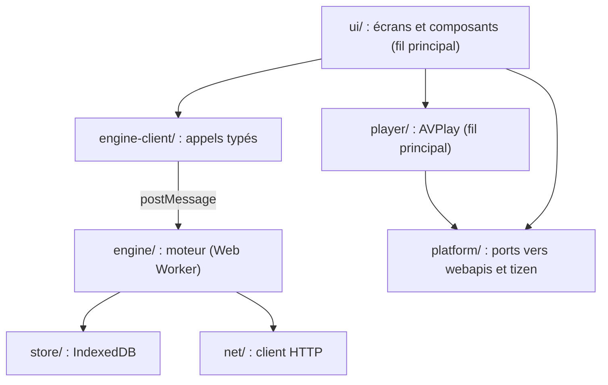

# PRD 05 — Architecture applicative

- **ID :** `PRD-05`
- **Prérequis :** `PRD-02`, `PRD-03`
- **Origine Buntu :** `README.md` (section Architecture), `crates/cnd-core/src/lib.rs`
- **Couches impactées :** structure de `src/`, conventions, adaptateurs de plateforme
- **Statut :** `[ ]`
- **Objectif :** tout traitement de plus de 16 ms sort du fil de l'interface ; 100 % de la logique métier se teste dans Node, sans TV.

---

## 1. Contexte & Objectif

`CndEngine` expose environ 170 fonctions à SwiftUI. La version TV garde cette séparation : un moteur sans interface, et une interface qui ne touche jamais au réseau ni au stockage.

## 2. Responsabilité

**Fait :** couches, frontières, contrat entre interface et moteur, adaptateurs de plateforme, tests de parité.

**Ne fait pas :** choix de stockage (`PRD-06`), détail des fonctions.

## 3. Spécifications

### 3.1. Couches

| Dossier prévu | Contenu | Interdit |
| :--- | :--- | :--- |
| `src/engine/` | Analyse, synchronisation, requêtes, recherche | DOM, `webapis`, `tizen` |
| `src/engine-client/` | Façade typée, annulation, erreurs | Logique métier |
| `src/player/` | Automate de lecture | Accès direct à la base |
| `src/ui/` | Écrans, focus, composants | `fetch`, IndexedDB, `webapis` |
| `src/platform/` | Ports et implémentations TV ou simulées | Logique métier |

`webapis` et `tizen` sont disponibles sur le fil principal. Si `S7` montre qu'une API manque dans un Worker, son appel passe par un port relayé.

### 3.2. Contrat moteur

Requêtes et réponses typées, avec identifiant de corrélation, annulation et progression. Les listes sont paginées : aucun appel ne renvoie plus d'une page. Les noms suivent `CndEngine` (`query_catalog` devient `queryCatalog`) pour que la comparaison avec Buntu reste facile.

### 3.3. Ports de plateforme

`PlayerPort`, `SecretStorePort`, `KeyInputPort`, `NetworkStatusPort`, `AppLifecyclePort`, `ScreenSaverPort`, `RemovableStoragePort`, `DeviceInfoPort`.

Chaque port a une implémentation TV et une implémentation simulée pour Chrome : une balise `<video>`, le clavier pour la télécommande, un magasin en mémoire pour les secrets. Le simulateur sert au développement. Il ne valide jamais une fonction de lecture.

### 3.4. Interface

TypeScript strict. Rendu avec une bibliothèque légère de type Preact, ou sans bibliothèque si le prototype du `PRD-14` le permet. Pas de framework lourd : budget de paquet dans le `PRD-12`. Dépendances à licence permissive seulement.

### 3.5. Parité avec `cnd-core`

Les règles métier sont réécrites, pas réinventées. Chaque PRD de portage reprend les cas de test Rust de son module sous forme de fixtures JSON d'entrée et de sortie, dans `tests/parity/`. Un écart volontaire est écrit dans le PRD concerné.

### 3.6. Erreurs

Un type d'erreur unique avec code stable (`network`, `auth`, `format`, `storage`, `limit`, `cancelled`). L'interface traduit le code en un message qui dit quoi faire.

## 4. Contraintes Non-Négociables (Guardrails IA)

- Pas d'import de `src/ui/` dans `src/engine/`, ni l'inverse, sauf les types partagés. Un linter le vérifie.
- Le fil principal ne reçoit jamais une liste complète.
- Aucun appel direct à `webapis` ou `tizen` hors de `src/platform/`.

## 5. Critères d'Acceptation

1. L'app vide tourne dans Chrome et sur TV avec les mêmes écrans.
2. Le linter de frontières échoue sur une violation volontaire.
3. Les tests du moteur tournent dans Node sans simulateur.

## 6. Sources

- [Memory Optimization](https://developer.samsung.com/smarttv/develop/guides/web-app-memory-optimization-guide.html)
- [Application Performance Improvement](https://developer.samsung.com/smarttv/develop/guides/application-performance-improvement/application-performance-improvement.html)
